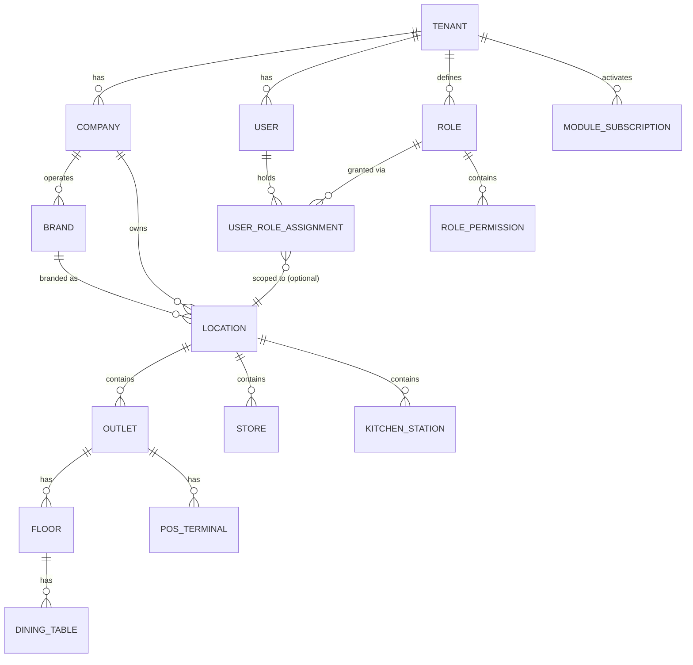
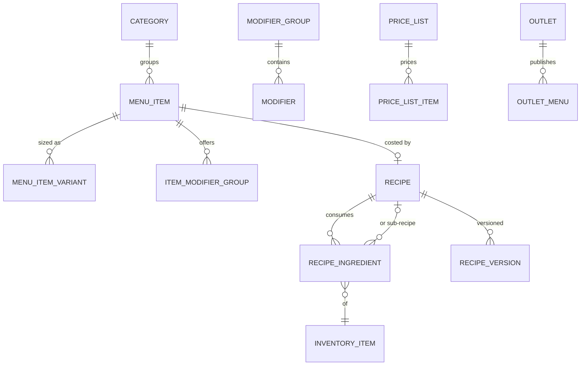
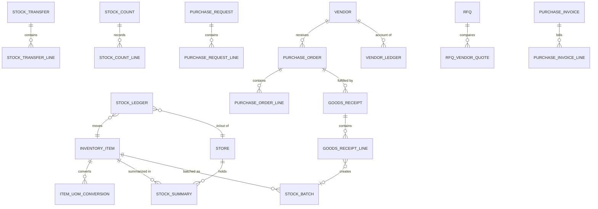
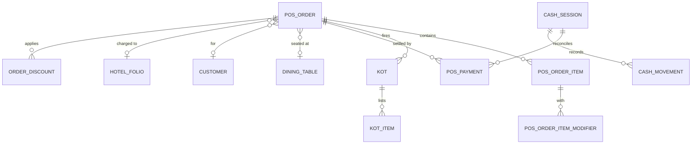
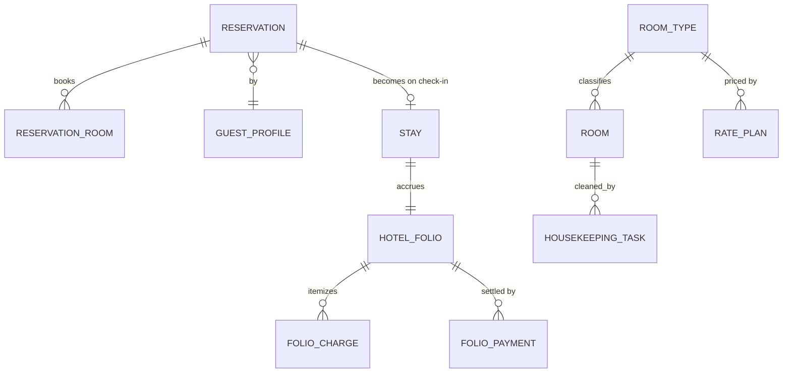
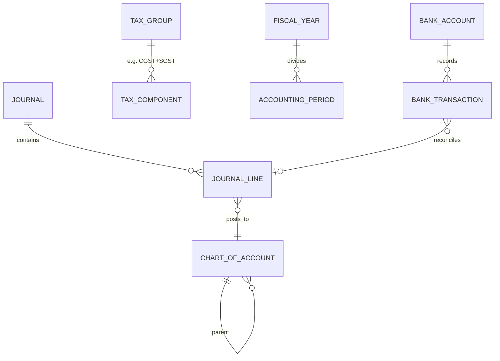

# Aureus — Database Design

**Version** 1.0 · Source of truth: [`packages/database/prisma/schema.prisma`](../packages/database/prisma/schema.prisma)

---

## 1. Conventions

- **PostgreSQL 16**, accessed via Prisma. All ids are **UUID v7** (time-ordered → index-friendly).
- Every tenant-owned table has `tenant_id` (indexed, part of RLS policy). Child tables carry it
  denormalized — never rely on joins for isolation.
- Money is `DECIMAL(14,4)` plus `currency` (ISO 4217) at document level; quantities
  `DECIMAL(14,4)`; tax rates `DECIMAL(6,3)`.
- Soft delete (`deleted_at`) only on master data (items, customers, vendors); **documents are
  never deleted** — they are cancelled/reversed with status + reversing entries.
- Timestamps `TIMESTAMPTZ`; business dates use the **location's timezone**; documents also store
  `business_date` (the operational day, which rolls at the outlet's day-close, not midnight).
- Append-only tables: `stock_ledger`, `journal`/`journal_line`, `audit_log`, `wallet_ledger`,
  `loyalty_ledger`, `vendor_ledger`. Balances are derived and cached in summary tables.
- High-volume tables (`pos_order`, `pos_order_item`, `stock_ledger`, `journal_line`,
  `audit_log`) are range-partitioned by month in production (managed by migration SQL, invisible
  to Prisma).
- Document numbering: `document_sequence` table (per tenant + company + doc type + fiscal year
  + optional terminal block) allocated with `SELECT … FOR UPDATE`; POS terminals pre-allocate
  blocks for offline operation.

## 2. Domain clusters

### 2.1 Organization & identity

Key decisions:
- `Role` has `is_system` (seeded catalog: Owner, Finance, Cashier, …) vs. custom roles.
  Permissions are strings from the shared **permission catalog** (`resource:action`), stored in
  `role_permission` — no permission table to migrate when features ship; catalog is code +
  validated at startup.
- `UserRoleAssignment` = (user, role, scope) where scope is tenant-wide, a company, or a
  location. Effective permission = union of assignments; data visibility = union of scoped
  locations.
- `PosTerminal` holds a device fingerprint + registration token; staff PIN login creates a
  terminal-bound short session.

### 2.2 Catalog & recipes

- **MenuItem (sellable) is separate from InventoryItem (stockable).** A menu item maps to stock
  either directly (bottled drink → `inventory_item_id`) or through a `Recipe` (BOM). Recipes
  nest via sub-recipes; `yield_qty`/`yield_uom` handles batch prep; versions freeze
  ingredient+cost history.
- Pricing: base price on variant; `PriceList` overrides per outlet/channel/day-part
  (happy hour = time-windowed price list with priority).

### 2.3 Inventory & procurement

- **`stock_ledger` is the single source of stock truth**: one row per movement with
  `movement_type` (opening, purchase, transfer_in/out, production_in/out, sale_consumption,
  adjustment, waste, count_variance), qty (+/−), `unit_cost`, batch, and a polymorphic source
  document reference. `stock_summary` (store × item → on-hand, avg cost) is maintained
  transactionally with each ledger insert for O(1) reads.
- Valuation: weighted-average maintained on `stock_summary`; FIFO cost layers derivable from
  batches; method configured per company.
- 3-way match: `purchase_invoice_line` references PO line + GRN line; posting validates
  qty/price tolerances from procurement settings.

### 2.4 POS & sales

- Order lifecycle: `draft → placed → in_kitchen → served → billed → settled | cancelled`;
  every status transition audited. Bills can split: child orders reference `parent_order_id`.
- `pos_payment` supports multiple tenders per order (mode, amount, reference, gateway payload,
  tip); `room_charge` mode links to a hotel folio; `credit` posts to customer receivable.
- Aggregator orders land as `pos_order` with `channel` + `external_ref` + commission fields.

### 2.5 Hotel

- Folio charges are polymorphic (room night, POS order, mini-bar, laundry, spa); night audit job
  posts room-night charges + rolls business date.

### 2.6 Accounting

- Journals carry `source_type`/`source_id` (pos_order, purchase_invoice, payroll_run,
  depreciation, manual) → full drill-down. Posting rules per event type map to configurable
  account slots (e.g. "Food revenue", "Input GST") so tenants can remap without code.
- `accounting_period.status = open|closed|locked` gates postings by `business_date`.

## 3. Integrity rules enforced in the database

- `CHECK` constraints: non-negative payments, journal line has exactly one of debit/credit > 0,
  stock summary qty consistency deferred to app+test (negatives allowed only where store setting
  permits).
- Uniques: `(tenant_id, company_id, doc_type, fiscal_year, number)` on documents;
  `(tenant_id, code)` on masters; partial uniques exclude soft-deleted rows.
- FKs are always intra-tenant; composite FKs `(tenant_id, id)` on the hottest paths make
  cross-tenant references unrepresentable.
- RLS policies on all tenant tables: `USING (tenant_id = current_setting('app.tenant_id')::uuid)`.
